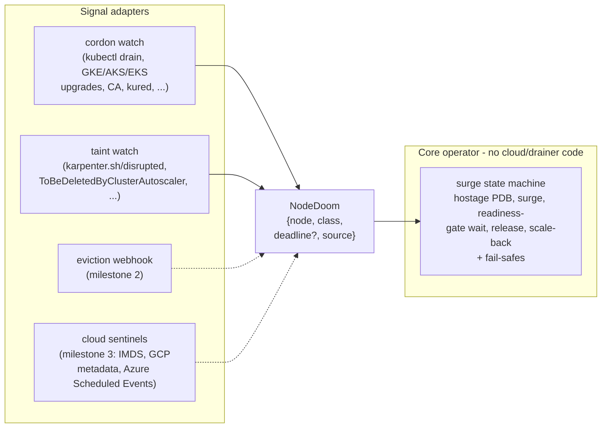

# Understudy

> **HA with 1 replica.** Run singleton workloads on spot nodes and survive everything a cluster throws at them - without paying for a second replica.

In theater, the understudy rehearses and steps in when the lead exits. Understudy the operator does the same for single-replica Deployments: when a node is doomed, it spins up a temporary stand-in pod, waits until it is **traffic-ready**, and only then lets the original leave. The second pod exists for the minutes a disruption is actually in flight - not for the 720 hours a month you'd pay to keep a permanent replica idling.

```yaml
apiVersion: apps.understudy.dev/v1alpha1
kind: Understudy
metadata:
  name: my-service
spec:
  targetRef:
    name: my-service          # a Deployment in the same namespace
  hostageMode: always          # always | voluntary-only | off
  minSurgeTimeSeconds: 60      # your realistic signal -> traffic-ready time
  readinessDeadlineSeconds: 600 # never-wedge TTL
```

## The problem

A single-replica Deployment goes down for `reschedule + image pull + boot + LB registration` every time anything touches its node:

| Class | Examples | Time available |
|---|---|---|
| **Involuntary, deadlined** | Spot/preemptible reclaim (AWS ~120s, GCP ~30s, Azure ~30s), maintenance events | seconds-minutes, hard deadline |
| **Voluntary, unbounded** | Node drift/rotation, cluster/node-pool upgrades, consolidation, manual `kubectl drain` | as long as the eviction is held |
| **Deploy-time** | Rolling update of the workload itself | N/A - Deployments already surge; Understudy stands down |

Running 2 replicas solves this by paying double, forever, against events that occupy minutes per month. Understudy's premise: if your workload can tolerate two pods *briefly* (the same property a rolling update with `maxSurge: 1` already demands), the second pod should exist only while a disruption is in flight.

## How it works

1. **Hostage PDB** - Understudy maintains a PodDisruptionBudget with `minAvailable = replicas`, so every graceful eviction is blocked (429) and effectively routed through the operator. Every relevant drainer - Karpenter, cluster-autoscaler, GKE/AKS/EKS upgrades, descheduler, `kubectl drain` - evicts via the Eviction API and retries while blocked.
2. **Surge on signal** - adapters normalize every dialect of "this node is dying" into one internal signal (`NodeDoom`); the core scales the target 1->2 and stamps the doomed pod with a negative [`pod-deletion-cost`](https://kubernetes.io/docs/concepts/workloads/controllers/replicaset/#pod-deletion-cost).
3. **Traffic-ready wait** - the understudy counts only when its pod is `Ready` *including all pod readiness gates* - which is exactly how the AWS LB controller, GKE NEGs and Azure AGIC express "registered and receiving traffic". Multi-cloud traffic-awareness with zero provider code.
4. **Release** - with the understudy ready, the PDB math allows one disruption; the drainer's own retry evicts the old pod gracefully. Zero downtime.
5. **Scale back** - once the old pod is gone, replicas return to baseline. The deletion-cost stamp guarantees any scale-down removes the old pod, never the fresh one.

For **deadlined** disruptions (spot reclaim), holding a hostage can only waste the clock: if the announced deadline is shorter than your `minSurgeTimeSeconds`, Understudy releases the eviction immediately, surges in parallel, and lets the old pod spend its remaining seconds draining connections.

## Architecture

Strict core/adapter split. The core operator contains **zero cloud- or drainer-specific code**; it consumes one normalized signal. A new drainer is a config entry or a small adapter - never a core change.



### The signal matrix

| Cloud | Disruption | Observable signal | Adapter | Lead time |
|---|---|---|---|---|
| any | `kubectl drain`, kured, NTH, node-maintenance tools | cordon (`spec.unschedulable`) | cordon (M1) | unbounded (held) |
| any | cluster-autoscaler | `DeletionCandidateOfClusterAutoscaler` (early, soft) -> `ToBeDeletedByClusterAutoscaler` + cordon | taint (M1) | minutes / unbounded |
| EKS, AKS-NAP, self-hosted | Karpenter v1 (drift, consolidation, expiry) | `karpenter.sh/disrupted` taint - **Karpenter never cordons** | taint (M1) | unbounded (held) |
| EKS | managed node group rotation | cordon | cordon (M1) | 15 min to force |
| GKE | upgrades, auto-repair | cordon + drain | cordon (M1) | <=1 h to force |
| AKS | upgrades, node-image rotation | cordon + drain | cordon (M1) | 30 min default to timeout |
| any | any evictor, incl. future ones | `pods/eviction` CREATE seen by observe-only webhook - even attempts the PDB rejects | webhook (M2) | 0 (catch-all) |
| AWS | spot interruption / rebalance | IMDS `spot/instance-action`, `events/recommendations/rebalance` | sentinel (M3) | ~120 s / early best-effort |
| GCP | spot preemption | metadata `instance/preempted` -> ACPI | sentinel (M3) | ~30 s (GKE pods get 15 s) |
| Azure | spot `Preempt` / `Redeploy` / `Terminate` | Scheduled Events API (events can be held & approved early) | sentinel (M3) | 30 s / 10-15 min / 5-15 min |

## Fail-safes

Each of these is a lesson from a production incident with prior art in this space:

- **Never-wedge TTL** - a blocked eviction with no surge progress past `readinessDeadlineSeconds` relaxes the PDB, emits an event, and increments `understudy_pdb_relaxed_total`. A blocked drain becomes an alert, never a 126-day-old node.
- **Fail-open everywhere** - if the operator is down, the cluster degrades to plain-Kubernetes behavior. Owned PDBs carry an ownership label with a one-command escape hatch: `kubectl delete pdb -A -l understudy.dev/owned=true`.
- **Self-exclusion** - the operator refuses to manage itself; it is stateless and treats its own fast reschedule as its availability story.
- **Graceful unsupported-ness** - unsupported targets (StatefulSets, missing Deployments) get a clear condition and event, then silence. Never an error loop.
- **Rollout stand-down** - a Deployment mid-rollout is already surging; Understudy detects it and stays out of the way. It also surfaces a warning condition if your update strategy itself drops traffic (`maxUnavailable > 0` or `maxSurge < 1`).

**Alert on `understudy_oldest_blocked_eviction_seconds`.** It is exported precisely so that "Understudy is holding an eviction" is always a visible, bounded state.

## Install

```sh
helm install understudy ./charts/understudy -n understudy-system --create-namespace
```

Then create an `Understudy` per workload (see the example up top). `kubectl get understudies` shows target, mode, phase and how long an eviction has been blocked.

## Honest limitations

- **Involuntary reclaims may still blip.** On GCP/Azure spot the notice (~30 s, and GKE grants regular pods just 15 s of it) is below any realistic surge; Understudy's value there is *fast, orderly release + parallel replacement*, not zero downtime. On AWS (~120 s) zero downtime is achievable only if the surge pod fits existing capacity with a pre-pulled image. Kubelet Graceful Node Shutdown kills pods regardless of PDBs when the deadline lands - no PDB can save a pod from a dying VM.
- **Consolidation may quietly stop.** Karpenter dry-runs PDBs and may never begin consolidating a node that hosts a hostage-protected pod (cluster-autoscaler pre-checks similarly). You keep availability but can lose bin-packing on those nodes. Disruption-candidate signals to fix this properly are on the [roadmap](docs/roadmap.md).
- **GitOps controllers will fight the surge.** Argo CD/Flux may reset `spec.replicas` mid-surge. Add an `ignoreDifferences` rule for targeted Deployments' `spec.replicas` (recipes in the roadmap).
- **Workloads that can never run two instances are out of scope.** If two pods can't briefly coexist, no surge-based approach (including rolling updates) can help; Understudy skips nothing silently - 1-replica StatefulSets get an explicit `TargetSupported: False` condition.
- **`pod-deletion-cost` is beta** (default-on in all supported Kubernetes). Without it, scale-down ordering falls back to Kubernetes defaults - still usually correct (delete-newest), no longer guaranteed.
- The eviction webhook (milestone 2) and cloud sentinels (milestone 3) are designed but not yet implemented - today's signals are cordon + taints, which cover every mainstream *voluntary* drainer.

## Development

```sh
make test    # envtest-based suite (downloads kubebuilder assets on first run)
make lint    # golangci-lint (builds a custom binary with logcheck)
make build   # manager binary in bin/
```

See [docs/roadmap.md](docs/roadmap.md).

## License

Apache-2.0
