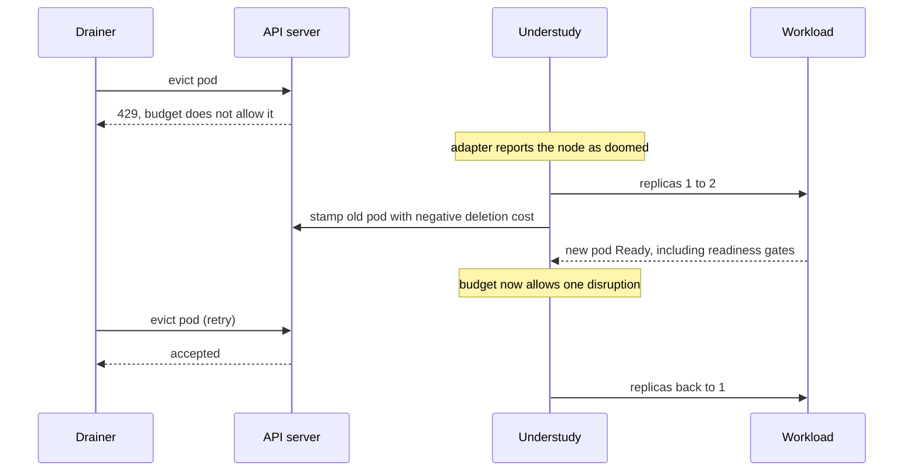
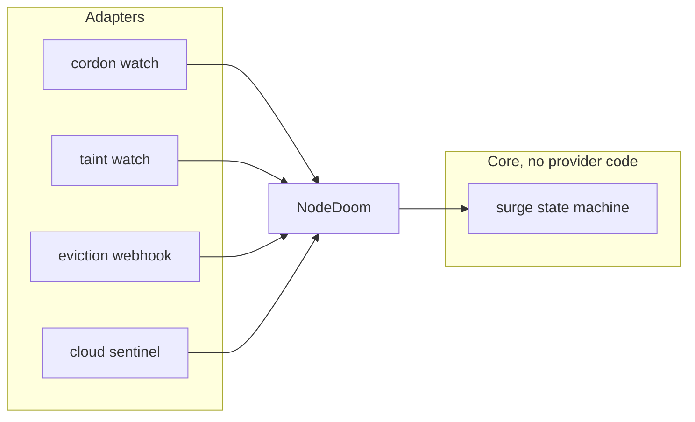
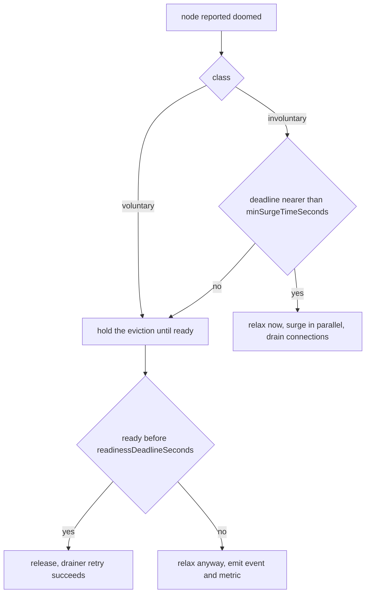

# How Understudy works

This document explains the mechanism in enough detail to reason about what
happens to your workload during a disruption, and to debug it when something
looks wrong.

## The problem

A Deployment with one replica has no redundancy, so any event that removes its
pod removes the service. Kubernetes offers PodDisruptionBudgets to protect
against this, but a budget cannot create capacity. With one replica, a budget
either blocks the disruption entirely (and stalls the drain) or permits it
(and you lose the service until the pod is rescheduled).

The gap between those two options is where Understudy sits. It notices that a
node is going away, brings up a second pod somewhere healthy, waits until that
pod is actually serving traffic, and only then lets the original be evicted.

## The mechanism

Five steps, in order.

**1. Take the eviction hostage.** For each `Understudy` resource, the operator
maintains a PodDisruptionBudget whose `minAvailable` equals the target's
current replica count. With one replica that means zero disruptions are
allowed, so every graceful eviction is rejected with HTTP 429. This is not a
denial of service: every drainer that matters retries. `kubectl drain` retries
every five seconds, Karpenter retries continuously, cluster-autoscaler retries
for two minutes. Blocking is how the operator buys time to arrange a
replacement.

**2. Notice the node is doomed.** Signal adapters watch for the various ways a
cluster announces a departing node and normalise all of them into one internal
value. See [Signals](#signals).

**3. Surge.** The operator raises the target's replica count by one and records
the original count in an annotation on the Deployment, so the state survives an
operator restart and is visible to a human mid-incident. It also stamps the
doomed pod with a negative `controller.kubernetes.io/pod-deletion-cost`, which
tells the ReplicaSet controller to prefer deleting that pod when scaling back
down.

**4. Wait for traffic readiness, then release.** The new pod counts only once
its `Ready` condition is true, which includes every pod readiness gate. This
matters more than it first appears: with a load balancer in front of the
service, pod-Ready alone does not mean the load balancer has registered the
pod. The AWS Load Balancer Controller, GKE NEGs and Azure AGIC all express
registration through readiness gates, so waiting for `Ready` gives correct
behaviour on all of them without a line of provider-specific code.

Once the replacement is ready there are two pods, the budget now permits one
disruption, and the drainer's next retry succeeds on its own. The operator does
not evict anything itself.

**5. Scale back.** When the doomed pod is gone, replicas return to the original
count. The deletion-cost stamp ensures the pod that goes is the old one.



## Signals

The core of the operator contains no cloud-specific or drainer-specific code.
It consumes exactly one value:

```go
NodeDoom{
    Node      string
    Class     VoluntaryUnbounded | Involuntary
    Deadline  *time.Time
    ExpiresAt *time.Time
    Source    string
}
```

Adapters produce it. Adding support for a new drainer means adding a
configuration entry or a small adapter, never touching the state machine.



**Cordon watch** looks for `spec.unschedulable`. This covers `kubectl drain`,
GKE and AKS and EKS upgrade drains, cluster-autoscaler, kured, and most
in-house tooling.

**Taint watch** looks for a configurable list of taint keys. Matching is by key
only, because the values carry no useful information: cluster-autoscaler stores
the timestamp at which it applied the taint, and Karpenter's taint has no value
at all. Defaults cover Karpenter (`karpenter.sh/disrupted`) and
cluster-autoscaler (`ToBeDeletedByClusterAutoscaler` and, as an early hint,
`DeletionCandidateOfClusterAutoscaler`). Karpenter never cordons, so without
this adapter a Karpenter-managed cluster produces no signal at all.

**Eviction webhook** is the catch-all. It watches `pods/eviction` CREATE and
always admits; the budget does the blocking. Because admission runs before the
budget is evaluated, the webhook sees attempts that are subsequently rejected
with 429, which means it sees every drainer including ones that neither cordon
nor taint. It only reports a signal when the evicted pod is covered by a budget
this operator owns, so an unrelated eviction on the same node does not disturb
your workload. The webhook is fail-open: if the operator is down, evictions are
admitted normally.

**Cloud sentinels** are the only optional component, and they are off by
default. Nothing else depends on them: the three adapters above run inside the
operator pod, and on Karpenter clusters even spot interruptions arrive without
a sentinel, as the taint Karpenter applies when it consumes its interruption
queue. What a sentinel adds is the deadline. It is a DaemonSet that reads the
cloud's termination notice, which is only served on the instance's own
link-local metadata endpoint, and taints its own node with the time remaining.
Reporting through a taint rather than a network call means the signal survives
an operator restart, is visible in `kubectl describe node`, and, because the
taint carries `NoSchedule`, keeps the replacement pod off the dying node for
free. Scope it to preemptible node pools; if you skip it entirely, set
`readinessDeadlineSeconds` below the platform notice window for spot
workloads.

| Cloud | Source | Notice |
|---|---|---|
| AWS | IMDS spot interruption notice, optionally rebalance recommendations | about 2 minutes |
| GCP | metadata server preemption flag | about 30 seconds, and the shutdown has already begun |
| Azure | Scheduled Events, `Preempt` and `Terminate` and `Redeploy` | 30 seconds for preemption, 5 to 15 minutes otherwise |

Only the AWS probe has been validated against real infrastructure. The GCP and
Azure probes are covered by unit tests against fake metadata servers and should
be treated as experimental.

## Deciding whether to hold or release

Holding an eviction is only useful when time is unbounded. If the node will be
destroyed at a fixed moment regardless of what any budget says, then blocking
the graceful eviction path does not save the pod. It only wastes the window in
which the pod could have been draining its connections.

So an involuntary signal carries a deadline, and the operator compares it to
`minSurgeTimeSeconds`, your estimate of how long this workload takes to go from
signal to serving traffic. If the deadline is nearer than that, the budget is
relaxed immediately, the surge still happens in parallel, and the old pod
spends its remaining seconds shutting down cleanly.

This is why the deadline travels with the signal instead of being a constant.
Two minutes on AWS is thirty seconds on GCP and Azure.



## Phases

`kubectl get understudies` shows a phase.

| Phase | Meaning |
|---|---|
| `Idle` | Nothing is happening. The budget is in place and blocking. |
| `Surging` | A doomed node was seen. The replacement is not ready yet. |
| `Releasing` | The replacement is serving traffic. The eviction can proceed. |
| `Relaxed` | The budget was opened without a ready replacement, either because the deadline was too near or because the readiness deadline expired. |
| `Unsupported` | The target is not something Understudy can protect. Nothing will happen. |

## Failure behaviour

Every one of these exists because a production incident showed what happens
without it.

**A blocked drain must never be permanent.** If a surge makes no progress for
`readinessDeadlineSeconds`, the budget is relaxed, an event is emitted and
`understudy_pdb_relaxed_total` increments. The workload takes a brief outage
instead of the node being stuck forever. This matters most on clusters where
the drainer waits indefinitely, which is Karpenter's default.

**An operator outage must not leave the cluster wedged.** The operator
heartbeats an annotation on the budgets it owns, and a CronJob deletes budgets
whose heartbeat has gone stale. Within a few minutes of the operator
disappearing, the cluster is back to plain Kubernetes behaviour. There is also
a manual escape hatch, since every budget it creates is labelled:

```sh
kubectl delete pdb -A -l understudy.sh/owned=true
```

**The operator never manages itself.** It is stateless, so its own availability
story is a fast reschedule, not a surge.

**Unsupported targets are skipped quietly.** A StatefulSet or a missing
Deployment produces a condition and an event, then silence. No error loop.

**A rollout is left alone.** A Deployment that is already rolling is already
surging, so Understudy stands down rather than fighting it.

## What to alert on

`understudy_oldest_blocked_eviction_seconds` is the one that matters. It is the
age of the oldest currently-blocked eviction, and it exists so that "Understudy
is holding something" is always a visible, bounded state. Alert if it stays
high.

The others: `understudy_surges_total` by signal class,
`understudy_pdb_relaxed_total` by reason, and
`understudy_eviction_attempts_observed_total` split by whether the pod was
protected.

## Limits worth knowing before you deploy

Understudy guarantees a ready replacement. It does not change what happens to
requests already in flight to the departing pod. Measured on a workload that
exits immediately on SIGTERM, a node drain lost one request in 350, which is
the same loss as an ordinary rolling update of the same workload. If you care
about those requests, give the pod a `preStop` hook that outlives the load
balancer's deregistration delay. That is a workload concern and no surge
mechanism can fix it.

On a cold cluster with no spare capacity the replacement has to wait for a new
node. For voluntary disruption this costs nothing but time, because the budget
holds the eviction while the node is provisioned. For an involuntary deadline
it is a race: a fast-booting workload can complete the handover inside AWS's
two minutes, but a slow one cannot, and thirty seconds on GCP or Azure is not
winnable at all. In those cases the value is an orderly release and a
replacement started as early as possible, not zero downtime.

Karpenter checks budgets before it begins consolidating a node, so a protected
workload can prevent its node from being consolidated at all. You keep
availability and lose some bin-packing.

Workloads that cannot tolerate two simultaneous instances are out of scope, and
that is permanent. If two pods cannot overlap briefly, no surge-based approach
works, including ordinary rolling updates.
